# 安全盾 SafeShield · 整合版总方案

> 本文档是产品的**最高层方案**,统筹并取代 01 号的单一定位。它把两条能力线整合为一款安全防护软件:
> **① 配置体检(按需快照 + 评分)** 与 **② 持续守护(常驻运行时监控 / IDS)**。
> 技术栈:**全 Swift 原生重写**(把本机既有 `monitor.py` 的检测逻辑移植为 Swift 检测器)。
> 防护姿态:**默认只读检测;发现风险后由用户显式确认才执行处置,全程审计、尽量可回滚。**
>
> 配套文档:`02-安全盾SafeShield-PRD.md`(需求)、`03-安全盾SafeShield-开发设计.md`(技术设计)。三者以本文为准。

---

## 一、为什么要整合:两种能力本是互补的两半

在做整合前,先明确既有资产的定位,这是整个方案的地基。

原三份文档(01/02/03)描述的 SafeShield 是一款**"安全体检"工具**:用户点一下,系统在几分钟内做一次**快照式**检查(SIP、FileVault、Gatekeeper、防火墙、TCC 权限、启动项、文件签名、监听端口、账户),给出评分和修复引导,然后结束。它回答的是**"我的系统配置卫生吗"**。

本机已经在运行的 `monitor.py`(LaunchAgent,每 60 秒一轮)则是完全不同的东西:它是一个**常驻的运行时入侵检测(IDS)**,通过**基线差分**发现异常——新出现的监听端口、新增的 LaunchAgent/Daemon、高危目录里的新文件或文件被篡改、可疑命令行(挖矿/反弹 shell/`curl|sh`)、异常外连与高频连接、新增用户账户。它回答的是**"此刻有没有东西在我机器上搞事"**。

| 维度 | 配置体检(原 SafeShield) | 持续守护(monitor.py) |
|---|---|---|
| 触发方式 | 按需一次性 | 常驻周期性 / 事件驱动 |
| 检测对象 | 系统静态配置与卫生 | 运行时行为与状态变化 |
| 输出 | 评分 + 报告 + 修复引导 | 实时告警 + (可选)处置 |
| 时间维度 | 快照(此刻是否合规) | 差分(相对基线是否异常) |
| 缺失对方 | 不知道"正在发生"的攻击 | 不知道"配置本身"是否薄弱 |

**结论**:两者不是新旧替代关系,而是一款完整安全防护软件的两半。只做体检,发现不了正在运行的恶意进程;只做监控,发现不了 FileVault 没开、SIP 被关这类根本性隐患。整合版把两者收进**同一款 App、同一套检测器插件框架、同一套规则引擎、同一个评分/告警体系**,对外呈现为一个产品的两种模式。

---

## 二、产品重新定位

**安全盾 SafeShield** 是一款面向 macOS 个人用户与轻量企业终端的**原生安全防护软件**,提供两种协同工作的模式:

- **体检模式(Scan)**:按需一键体检,覆盖 6 大维度 40+ 项配置与文件检查,3 分钟内产出带评分的可视化报告与修复引导。
- **守护模式(Guardian)**:常驻后台,以基线差分方式持续监控进程、网络、启动项、文件与账户的运行时变化,发现异常即时告警;高危项可由用户确认后一键处置。

两种模式**共享底层**:同一套 Detector 插件、同一个规则引擎、同一份能力/权限探测、同一个报告与告警中心。体检模式产出的"基线快照"可直接作为守护模式差分检测的初始基线,二者天然衔接。

**产品伦理与合规底线(整合后修订)**:所有检测行为限定在**本机、防御性**范围;默认**只读**;任何处置动作(终止进程、隔离文件、封禁 IP)都必须**用户显式确认**、**完整审计**、**尽可能可回滚**,不可逆动作需二次确认并明示后果。绝不做渗透、不探测第三方主机、不做流量劫持、不在未授权时外发任何数据。

---

## 三、整合后的能力地图

把原有 F1–F9 与 monitor.py 的检测项统一编排为**两类检测器**,归入同一维度体系:

| 维度 | 快照检测器(体检模式) | 持续检测器(守护模式,移植自 monitor.py) |
|---|---|---|
| 系统配置 | SIP / FileVault / Gatekeeper / 防火墙 / 自动更新 / 版本落后 / 锁屏密码 | —(配置变更可选纳入守护:定期复测关键开关) |
| 隐私权限 | TCC 敏感权限清单、授权应用签名校验 | 权限变更监测(可选订阅,新增敏感授权提醒) |
| 启动项/持久化 | LaunchAgents/Daemons、登录项、Cron、浏览器扩展的签名与公证校验 | **新增**启动项差分告警(尤其 LaunchDaemons) |
| 文件完整性 | 拖拽文件 SHA-256 + 签名/公证校验、下载目录未签名可执行文件扫描 | 高危目录**新文件**与**文件被篡改**的哈希差分 |
| 网络 | 监听端口快照、Wi-Fi 安全性、DNS 可信度 | 新增监听端口、公网连接、高频连接、可疑端口连接 |
| 进程行为 | —(体检不含) | 可疑命令行关键字、临时目录执行 |
| 账户 | Apple ID 2FA(引导)、自动登录、其他用户账户 | 新增用户账户差分告警 |

**评分与告警的关系**:体检模式产出 0–100 的**健康评分**(配置卫生);守护模式产出**实时告警流**(运行时事件)。两者在仪表盘并存:顶部是最近一次体检评分环,下方是守护模式的实时事件/告警时间线。菜单栏图标状态取两者最严重者(体检高危或守护活跃告警都会变红)。

---

## 四、整合架构总览

```mermaid
flowchart TB
    subgraph Pres["表现层 (SwiftUI + AppKit)"]
        UI1[仪表盘<br/>评分环 + 实时告警流]
        UI2[守护中心<br/>事件时间线 / 处置确认]
        UI3[报告中心 / 趋势]
        UI4[设置 / 隐私中心]
        UI5[菜单栏 MenuBarExtra]
    end
    subgraph App["应用层"]
        C1[ScanCoordinator<br/>体检编排]
        C2[GuardianCoordinator<br/>守护编排]
        C3[ResponseCoordinator<br/>处置编排 + 审计 + 回滚]
        C4[RemediationRouter<br/>深链跳转]
    end
    subgraph Dom["领域层"]
        E1[ScanEngine 快照调度]
        E2[GuardianEngine 周期/事件调度]
        RE[RuleEngine 分级 + 评分]
        REG[DetectorRegistry]
        CAP[CapabilityProbe 能力探测]
        AP[ActionPolicy 处置策略/授权门控]
        BS[BaselineStore 基线状态]
    end
    subgraph Det["检测器插件层"]
        SD[快照检测器 ×6]
        CD[持续检测器 ×6<br/>移植自 monitor.py]
    end
    subgraph Infra["基础设施层"]
        I1[SystemInfoGateway]
        I2[SecurityFrameworkGateway]
        I3[ProcessRunner 白名单命令]
        I4[PrivilegedHelper XPC<br/>root 特权采集 + 处置执行]
        I5[HashService]
        I6[ThreatIntelClient TLS+证书固定]
        I7[ReportStore SwiftData]
        I8[AuditLog 处置审计]
        I9[Logger OSLog]
    end
    Pres --> App --> Dom --> Det --> Infra
```

三条设计主线继承自原 03 号文档并强化:

1. **插件化检测器**:新增 `DetectorKind = { snapshot, continuous }`。快照检测器实现 `detect() -> [Finding]`;持续检测器实现 `observe(baseline) -> [Event]`,内部做差分。两类都注册进同一 `DetectorRegistry`,共享规则引擎与能力探测。
2. **规则外置**:`rules.default.json` 同时承载体检规则(带权重、评分)与守护规则(带告警级别、是否可处置)。monitor.py 里的 `suspicious_keywords`、`suspicious_ports`、`watch_paths` 直接转成守护规则条目。
3. **能力探测 + 特权门控**:编译期决定渠道能不能,运行期决定用户有没有授权。新增 `ActionPolicy` 层,把"检测"与"处置"彻底解耦——检测永远只读,处置永远经过策略门控与用户确认。

---

## 五、处置框架:检测与响应分离(整合版的核心新增)

这是把 monitor.py 的 kill/block/quarantine 能力纳入产品、同时守住合规红线的关键设计。原 monitor.py 用 `auto_kill/auto_block/auto_quarantine` 三个开关控制自动处置(当前全为 `false`);整合版**取消"全自动处置"作为默认路径**,改为**"检测产出建议动作 → 用户确认 → 特权执行 → 审计 → 可回滚"**的闭环。

### 5.1 三级处置姿态(设置中可选,默认第二级)

| 姿态 | 行为 | 适用 |
|---|---|---|
| **只读(ReadOnly)** | 只告警,不提供任何处置按钮,纯引导到系统设置 | 保守用户 / App Store 版 |
| **确认后处置(Confirm,默认)** | 高危事件产生"建议动作",用户在告警中心逐项或批量确认后执行 | 个人用户推荐 |
| **半自动(Semi-Auto)** | 仅对**可回滚**动作(隔离文件)在用户一次性授权策略后自动执行,并立即通知;kill/block 仍需逐项确认 | 高级用户 / 企业终端 |

无论哪一级,**终止进程(kill)和封禁 IP(block)永远需要逐项确认**,因为不可逆或影响面大;隔离文件(quarantine)因可从隔离区还原,可在半自动模式下按策略执行。

### 5.2 特权助手(Privileged Helper)

非特权进程(如 monitor.py 以 LaunchAgent 用户态运行)有两个硬限制:**① `lsof -i` 只能看到本用户进程的端口与连接,系统级守护进程是盲区;② `pfctl` 封禁、跨用户 kill 需要 root,而 `sudo` 在无 tty 环境不可用**。整合版通过 `SMAppService` 注册一个 **root 特权的 XPC Helper** 解决:

- **采集侧**:Helper 以 root 运行 `lsof`/`netstat`,回传全机端口与连接,补齐守护模式与 F6 网络体检的盲区。
- **执行侧**:处置动作(kill / pfctl block / 文件隔离)由 Helper 执行,主 App 通过 XPC 下发结构化指令(非 shell 字符串),Helper 侧再做白名单与参数校验,杜绝命令注入。
- **授权**:首次启用处置能力时弹一次系统授权(admin),之后由 Helper 常驻;用户可随时在设置中撤销。
- **App Store 版**:不含 Helper(沙盒不允许),守护模式降级为"仅用户态可见范围",处置能力整体不可用,退化为引导——符合双轨策略。

### 5.3 审计与回滚

- **审计日志**:每一次处置都记录 `{动作, 目标, 触发规则/事件, 时间, 授权方式, 执行结果}`,存于独立 `AuditLog`(不可由普通流程改写),用户可在"守护中心"查看与导出。
- **回滚**:
  - 文件隔离 → 隔离区可一键还原(保留原始路径与权限);
  - IP 封禁 → 可一键解除(pfctl 规则可移除);
  - 进程终止 → **不可回滚**,故执行前二次确认并明示"该进程将被强制结束,未保存数据可能丢失";
  - 每次处置在建议阶段就标注"是否可逆",UI 对不可逆动作用醒目样式。

---

## 六、评审发现的可行性硬伤 —— 整合版统一修订

原三份文档里有几处"想用但 Apple 不给公开 API / 与自身约束矛盾"的点,在本方案层面统一给出结论,PRD 与设计文档据此修订:

| 原条目 | 问题 | 整合版处理 |
|---|---|---|
| EndpointSecurity(01 §2 称"只读评估") | ES 是实时事件流,需 Apple 专项审批 entitlement,沙盒版拿不到 | 完整版**可选**申请 ES 做真实时进程/文件事件;拿不到则退化为**轮询快照差分**(即 monitor.py 现有方式);App Store 版不用 ES |
| F7-1 检测 Apple ID 是否开启 2FA | 无公开 API 可读 | 改为**引导式自查**(图文步骤 + 跳转系统设置),不做自动判定 |
| F7-2 对接 Apple 密码泄露检测 / Keychain 口令比对 | 无公开 API;读钥匙串口令必触发逐条授权,且违反"不读口令明文"红线 | **删除自动比对**;改为跳转"系统设置 > 密码"的引导,只做计数提示不可行则纯引导 |
| F3-2 Screen Time 读取 90 天未使用 | DeviceActivity/ManagedSettings 属受限 entitlement,普通应用读不到 | 标注为"能力可用时启用,否则自动跳过",不作为承诺型验收标准 |
| F6-1 列出全机监听端口 | 非特权只能看本用户 socket,与 netstat 全量对不齐 | 通过**特权助手(§5.2)**采集全量;无 Helper 时明确降级口径 |
| F2-6 版本落后判定需联网 | 与"全程无网络可完成基础体检"张力 | 用随规则库更新的**"已知最新补丁表"**离线比对,联网仅用于刷新该表 |
| 03 代码 `ScanError.timeout(detectoID:)` | 拼写错误 | 修正为 `detectorID` |

---

## 七、双轨分发策略(整合版修订)

| 能力 | App Store 沙盒版 | Developer ID 完整版 |
|---|---|---|
| 体检模式(配置/文件/评分/报告) | ✅ 完整(部分只读项降级引导) | ✅ 完整 |
| 守护模式(持续监控) | ⚠️ 受限:仅用户态可见范围,无常驻特权,后台刷新受系统调度限制 | ✅ 完整:特权助手全量采集,可长驻 |
| 处置能力(kill/block/quarantine) | ❌ 不提供,退化为引导 | ✅ 用户确认后由特权助手执行 |
| 威胁情报云查杀 | ✅(用户授权文件的哈希) | ✅ |
| EndpointSecurity 实时事件 | ❌ | ⚠️ 可选(需专项 entitlement,否则轮询差分) |

**结论**:App Store 版聚焦**体检模式**,形成"配置体检 + 文件校验 + 报告中心"的独立闭环;**守护模式与处置能力是完整版的核心差异化卖点**。两版共用同一代码库(`SafeShieldCore` Framework),通过编译宏 `APPSTORE_BUILD` + 运行期能力探测裁剪功能,不可用项一律以"当前版本不支持 + 原因 + 升级引导"呈现,而非"检测失败"。

---

## 八、monitor.py 逻辑到 Swift 的移植映射

本机既有脚本不是废弃对象,而是**守护模式的规则与算法蓝本**。移植对应关系如下:

| monitor.py 元素 | 整合版 Swift 落点 |
|---|---|
| `state.json`(known_ports/known_files/known_launchagents/known_users) | `BaselineStore`(SwiftData/独立存储),体检快照可初始化基线 |
| `check_processes` + `suspicious_keywords` | `ProcessBehaviorDetector` + 守护规则 `GARD-PROC-*` |
| `check_listen_ports`(新端口差分) | `PortBaselineDetector` + 规则 `GARD-NET-PORT` |
| `check_established_connections` / `check_public_connections` | `NetworkConnectionDetector`(全量数据来自特权助手) |
| `check_watch_paths`(新文件/篡改,哈希) | `FileIntegrityMonitor` + `HashService` |
| `check_launchagents`(新增差分) | `PersistenceMonitor` |
| `check_system_accounts`(新增用户) | `AccountMonitor` |
| `kill_pid` / `block_ip` / `quarantine_file` | `ResponseCoordinator` 的动作类型,经 `ActionPolicy` 门控 + 特权助手执行 |
| `config.json` 各类白名单 | **通用化**:签名 Team ID + 系统路径为默认白名单;个人/企业专属项走**用户自定义白名单**(本地学习),**不硬编码进产品**(现清单含 本机既有企业安全软件与用户主目录路径,仅对本机有意义) |
| `log_event` / `notify`(osascript) | `Logger`(OSLog) + 系统通知 + 守护中心告警流 |

**重要提醒**:现有 `config.json` 的白名单/关键字清单是**为这一台机器调优的**,直接进产品会误报漏报。移植时把"通用规则"与"用户可学习的本地白名单"分离,前者随产品发布并可热更新,后者存用户容器、随使用积累。

---

## 九、路线图(整合版)

| 阶段 | 周期 | 范围 | 出口标准 |
|---|---|---|---|
| **M0 技术验证** | 2–3 周 | 沙盒权限 Spike、**特权助手(SMAppService+XPC)POC**、ES entitlement 可行性、评分与差分框架、Detector 双类型接口 | 双轨能力边界 + 处置授权链确认文档 |
| **M1 体检 MVP** | 6 周 | 体检模式全部(系统配置/隐私/文件/网络/账户/报告/设置),规则引擎与评分 | 内测包过公证,体检闭环可用 |
| **M2 守护模式** | 6–8 周 | 移植 monitor.py 全部差分检测器 + BaselineStore + 守护中心告警流 + 特权助手全量采集 | 常驻监控稳定运行,误报率达标 |
| **M3 处置框架** | 4 周 | ResponseCoordinator + ActionPolicy + 审计日志 + 回滚(隔离/封禁)+ 二次确认交互 | 处置全链路可审计、可回滚、通过隐私与安全审计 |
| **M4 上架与增强** | 3 周 + 持续 | 隐私标签、双渠道过审;威胁情报云查杀、企业巡检(MDM 批量报告)、ES 实时事件(可选) | 双渠道发布 |

**M0 必须优先验证的三件事**(决定后续架构):① 特权助手的授权体验与稳定性;② EndpointSecurity entitlement 能否申请到(拿不到就走轮询差分,不影响主体);③ App Store 版在无常驻特权下守护模式到底能做到什么程度(可能直接决定守护模式不进 App Store)。

---

## 十、Demo 与 MVP 行动项

把上面的路线图落到"先看得见、再跑得通"的两个近期目标。**Demo 只为验证界面与信息架构(不含真实检测逻辑),MVP 是可安装、能跑真实体检的最小闭环。**

### 10.1 Demo 行动项(界面原型,目标 1~2 天)

Demo 用**单文件 HTML 交互原型**先呈现界面(不依赖 Xcode/Swift 编译,便于快速评审视觉与交互),覆盖以下屏:

| 编号 | 行动项 | 验收 |
|---|---|---|
| D1 | 主窗口骨架:macOS 风格窗口(红绿灯/侧边栏/工具栏),侧边栏含 仪表盘 / 体检 / 守护中心 / 报告 / 设置 | 视觉接近原生 macOS App,深浅色可切 |
| D2 | **仪表盘**:顶部体检评分环 + 六维度小环;下方"守护实时告警流" | 用 mock 数据呈现评分与告警并存 |
| D3 | **体检页**:点"开始体检"→ 进度动画(逐项检测器名称)→ 风险列表(按严重度),每条带"去修复"深链按钮 | 交互可点击,`unavailable` 项折叠展示 |
| D4 | **守护中心**:运行时事件时间线(可疑进程/新端口/文件篡改/新启动项/异常外连),高危事件带"建议动作" | 事件卡片能体现 monitor.py 的检测维度 |
| D5 | **处置确认流(核心差异化)**:点"隔离/终止/封禁"→ 确认弹窗(不可逆动作二次确认+明示后果)→ 执行回执 → 审计记录 → 可回滚(隔离区还原/解除封禁) | 完整演示"检测-确认-处置-审计-回滚"闭环 |
| D6 | **报告中心**:历史趋势折线 + 单次报告详情 + 导出按钮(mock) | 呈现趋势与评分口径版本 |
| D7 | **设置**:处置姿态(只读/确认后/半自动)、守护开关与轮询间隔、白名单管理、特权助手授权/撤销、隐私中心 | 体现整合版新增的设置项 |
| D8 | 菜单栏形态示意 + 首次引导分页(能力边界/权限原因/隐私承诺) | 呈现常驻与引导体验 |

> Demo 数据全部为**标注清楚的 mock**(含本机既有企业安全软件作为"白名单命中不告警"的示例),不含真实系统读取,不做任何处置。

### 10.2 MVP 行动项(体检最小闭环,对应 M1,目标 6 周)

MVP 只做**体检模式**的真实可用闭环,守护与处置留到 M2/M3。范围与验收:

| 编号 | 行动项 | 验收 |
|---|---|---|
| V1 | Xcode 工程脚手架:双 Target(`SafeShield-AppStore`/`SafeShield-Direct`)+ 共享 `SafeShieldCore` Framework + CI(swiftlint/覆盖率门禁) | 两 Target 可编译,CI 绿 |
| V2 | 领域模型与协议定稿:`Finding`/`Severity`/`Dimension`/`ScanReport`;`Detector`(快照)协议;`DetectorRegistry`;`AppEnvironment` 依赖注入 | 单测覆盖协议契约 |
| V3 | `ScanEngine`:并发调度 + 单项超时隔离 + 协作式取消 | 全通过=100 分、超时降级、取消保留已完成项 |
| V4 | `SystemConfigDetector` 全 7 项(SIP/FileVault/Gatekeeper/防火墙/自动更新/版本落后〔离线补丁表〕/锁屏)+ `RuleEngine` 评分 + `rules.default.json` v1 | 与系统设置实际状态一致;同状态重复体检分数一致 |
| V5 | `PrivacyPermissionDetector`(TCC 清单,不可读时降级引导) | 权限清单与系统设置一致或明确降级 |
| V6 | `RemediationRouter` 深链矩阵:每项风险"去修复"跳转对应系统设置面板 | 真机验证深链可达 |
| V7 | `ReportStore`(SwiftData)+ 仪表盘 UI + 报告详情 + 导出 PDF/Markdown | 报告持久化、趋势可查、导出与页面一致 |
| V8 | 菜单栏 + 首次引导 + 设置/隐私中心 + Hardened Runtime + 公证打包 | 内测包过公证,基础体检闭环可用 |

**MVP 出口标准**:一台真机上,从首次引导 → 一键体检 → 评分报告 → 深链修复 → 导出,全流程跑通并通过公证;守护/处置入口以"完整版即将推出"占位或按渠道隐藏。

**建议顺序**:先做 Demo(§10.1)对齐界面与信息架构 → 评审通过后进 MVP(§10.2),Demo 的界面结构直接作为 SwiftUI 视图的实现蓝本。

### 10.3 已交付物与当前状态(2026-09-28)

| 交付物 | 位置 | 覆盖行动项 | 状态 |
|---|---|---|---|
| 界面交互原型(单文件 HTML,mock 数据) | `安全盾SafeShield-界面Demo.html` | D1–D8 全部 | 已交付并截屏评审通过 |
| 真实数据 MVP Demo(单文件 SwiftUI,`swiftc` 直编,无 Xcode 依赖) | `mvp/SafeShieldMVP.swift` | V2/V3/V4 的最小可运行验证(8 项真实检测 + 评分 + 风险列表 + 深链占位) | 已交付,真机运行验证通过 |
| **完整原生应用(M1 体检 + M2 守护 + M3 处置)** | `app/`(Sources 17 个 Swift 文件 + `build.sh` + `Info.plist` + `Resources/rules.default.json`,产物 `app/build/SafeShield.app`);安装包 `dist/SafeShield-0.9.0.dmg`(含 Applications 快捷方式与安装说明,SHA-256 见 `dist/SHA256SUMS.txt`) | M1 全部、M2 全部(六类差分检测器)、M3 处置框架(姿态门控/白名单拒绝/特权门控/二次确认/审计/隔离回滚);M4(签名公证、ES 授权、云查询)本机不具备条件,未实现 | 已交付,真机全流程验证通过(见下) |

完整应用的真机验证结果(2026-09-28,本机):

- **体检**:6 组快照检测器 21 项检查,总分 **96/优秀**(风险 4 / 通过 16 / 不计分 1);六维分 系统配置 100、隐私 100、驻留 87、文件 100、网络 100、账户 90。风险项均为真实命中:自动登录中危(`autoLoginUser=demo`)、24 个非白名单自启动项中危、登录项低危、管理员账户 3 个低危;证据串为命令真实输出。
- **守护**:基线首轮静默建立(端口/文件哈希/启动项/用户),第二轮起差分告警;向受控目录写入探针脚本后产生**单条**去重后的 `newFile` 中危事件并给出"隔离文件"建议动作(`/tmp` 与 `/private/tmp` 符号链接同址去重已验证)。
- **处置与合规红线**:内置自检(`--selftest`)7/7 通过——隔离真实移动+chmod 0、隔离回滚还原、白名单进程拒绝终止(Finder)、封禁 IP 因无特权助手仅记录建议、只读姿态阻断一切处置、不可逆动作需二次确认、未确认不执行;审计日志全量留痕(`audit.jsonl`)。
- **界面**:仪表盘 / 体检 / 守护中心 / 报告(历史+趋势+导出 Markdown) / 设置(姿态、白名单、隐私中心)五屏与确认弹窗均截屏验证。

运行方式:`cd app && ./build.sh && open build/SafeShield.app`;自动化验证启动参数:`--skip-onboarding --page <dashboard|scan|guardian|reports|settings> --guardian --scan --interval N --show-confirm --selftest --headless`。

真实数据 MVP Demo 的首轮验证结果(本机):总分 **96/良好**,8 项检测中 7 项通过、1 项中危(自动登录 `autoLoginUser=demo`),证据串均为命令真实输出(SIP enabled / FileVault On / assessments enabled / Firewall State=1 等),与 bash 基线逐条一致。

> **工程教训(已回写 03 设计 §9.1)**:`Process.executableURL` 不做 PATH 解析,白名单与调用必须写真实绝对路径。`spctl` 实为 `/usr/sbin/spctl`、`socketfilterfw` 实为 `/usr/libexec/ApplicationFirewall/socketfilterfw`;首轮 demo 因写成 `/usr/bin/spctl` 导致 Gatekeeper 被误判高危且证据为空。V4 实现时单测须覆盖"白名单路径全部存在"。

---

## 十一、合规红线(整合版修订)

1. 不扫描、不探测任何非本机目标;
2. **默认只读**;检测本身绝不修改系统;
3. 任何处置动作必须**用户显式确认**(kill/block 逐项确认,不可逆动作二次确认),**完整审计**,**尽可能可回滚**;
4. 不读取、不上传任何文件内容明文与口令明文;云查杀只上传哈希;
5. 不在用户未授权时进行任何数据外发,外发能力有独立开关与同意时间戳;
6. 特权助手遵循最小权限,只执行白名单内的结构化指令,不接受 shell 字符串拼接。

---

这套整合方案把"配置体检"与"运行时守护"统一在一款原生 App 内,以**插件化双类型检测器 + 规则外置 + 能力/特权门控 + 检测-响应分离**为支点:体检负责"防患于未然",守护负责"察变于即时",处置负责"止损于确认后",三者共享同一套引擎与评分/告警体系,既复用了本机既有脚本的检测智慧,又守住了产品的只读默认与合规底线。
