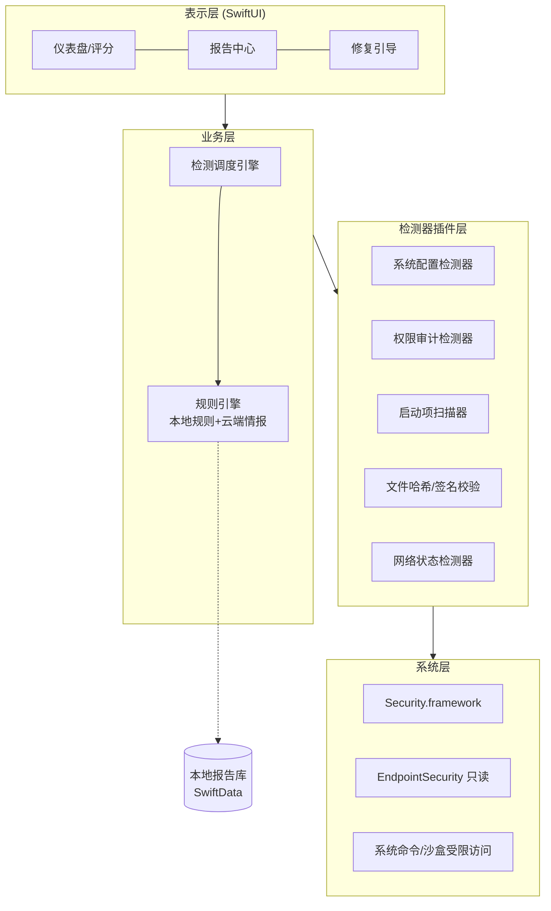

# macOS 安全体检应用 · 设计方案

> ⚠️ **本文档为初版概念稿，已被 `00-安全盾SafeShield-整合版总方案.md` 取代并扩展。** 整合版把产品从"一次性安全体检"升级为**"体检 + 持续守护"双引擎安全防护软件**（全 Swift 原生、检测+用户确认后处置），并修正了本文若干可行性问题（EndpointSecurity 定位、Apple 密码泄露/2FA API 等）。阅读顺序建议：00（总方案）→ 02（PRD）→ 03（开发设计）。以下内容保留作背景与演进参考。

> 用 Swift + SwiftUI 开发一款原生 macOS 安全体检应用，聚焦本地防御性检测（系统安全配置、隐私权限、可疑启动项等），只读检测不做任何渗透性操作，并通过沙盒与公证合规上架。

---

## 一、产品定位与边界

这款应用的定位是"个人安全体检工具"，类似 Mac 上的安全管家：帮助用户发现自身系统中已经存在的安全隐患和配置疏漏，而不是主动扫描攻击他人系统。所有检测行为都限定在**本机、只读、防御性**的范围内，这既是产品伦理要求，也是通过 App Store 审核和 Apple 公证（Notarization）的前提。

---

## 二、技术选型

| 层面 | 选择 | 理由 |
|---|---|---|
| 语言 | Swift 5.9+ | 原生性能与系统 API 访问最佳 |
| UI | SwiftUI（辅以 AppKit） | 现代声明式 UI，适配 macOS 14+ |
| 系统接口 | Security.framework、EndpointSecurity（只读评估）、System Extensions | 获取安全状态的官方途径 |
| 数据层 | SwiftData / Core Data + Keychain | 存储体检报告与历史趋势 |
| 分发 | App Store 或 Developer ID + 公证 | 保证自身供应链安全 |

---

## 三、核心功能模块

1. **系统安全配置体检**：检测 SIP（系统完整性保护）状态、FileVault 全盘加密是否开启、Gatekeeper 设置、防火墙状态、自动更新是否启用。
2. **隐私权限审计**：列出哪些 App 拥有麦克风、摄像头、屏幕录制、辅助功能、完全磁盘访问等敏感权限，标记长期未使用却仍持有权限的应用。
3. **启动项与持久化检查**：扫描 LaunchAgents / LaunchDaemons、登录项、浏览器扩展，对照已知恶意特征库（可自建 + 订阅开源威胁情报）标记可疑条目。
4. **文件哈希与签名校验**：对用户指定文件计算 SHA-256、验证代码签名与公证票据（`spctl` 同类能力），可选对接 VirusTotal 等云端多引擎查询 API。
5. **账户与口令健康**：检查是否存在弱密码提示、是否开启双重认证、Keychain 中泄露口令比对（对接 Apple 密码泄露检测 API）。
6. **网络状态概览**：本机监听端口列表、当前连接的 Wi-Fi 安全性（是否 WPA3、是否已知钓鱼热点）、DNS 是否为可信服务器。
7. **体检报告**：生成带评分的可视化报告，支持历史记录对比、一键跳转到系统设置对应修复位置（应用只提供引导，不代用户改系统）。

---

## 四、整体架构

采用**插件化检测器架构**：每个检测项是一个独立 Detector，统一实现 `run() -> Finding` 接口，新增检测能力只需注册新插件，规则引擎将结果按严重级别（高危/中危/提示）汇总评分。

---

## 五、权限与安全合规要点

- **最小权限原则**：优先使用 App Sandbox；确实需要的能力（如完全磁盘访问）通过 System Extension / 用户手动授权获得，并在 UI 中明确告知用途。
- **应用自身安全**：启用 Hardened Runtime、代码签名、公证；敏感配置存入 Keychain；如需云端威胁情报，传输走 TLS 1.3 并做证书固定。
- **合规红线**：不做端口扫描他人主机、不做漏洞利用、不做流量劫持；文件云查杀只上传哈希而非文件内容，避免隐私争议。
- **隐私声明**：所有检测默认本地完成，任何数据外发都需用户显式开启。

---

## 六、开发路线图

| 阶段 | 周期 | 交付物 |
|---|---|---|
| P0 原型 | 2~3 周 | 系统配置体检 + 评分仪表盘 |
| P1 MVP | 4~6 周 | 权限审计、启动项扫描、报告中心 |
| P2 增强 | 6~8 周 | 哈希云查杀、网络概览、历史趋势 |
| P3 上架 | 2 周 | 沙盒适配、公证/审核、隐私标签填写 |

技术验证的重点风险在于**沙盒限制**：部分检测（如读取其他 App 的 LaunchAgents）在纯 App Store 沙盒内不可行，建议早期先做 Spike 验证，决定走 App Store 版（功能受限）还是 Developer ID 独立分发版（功能完整）的双轨策略。
