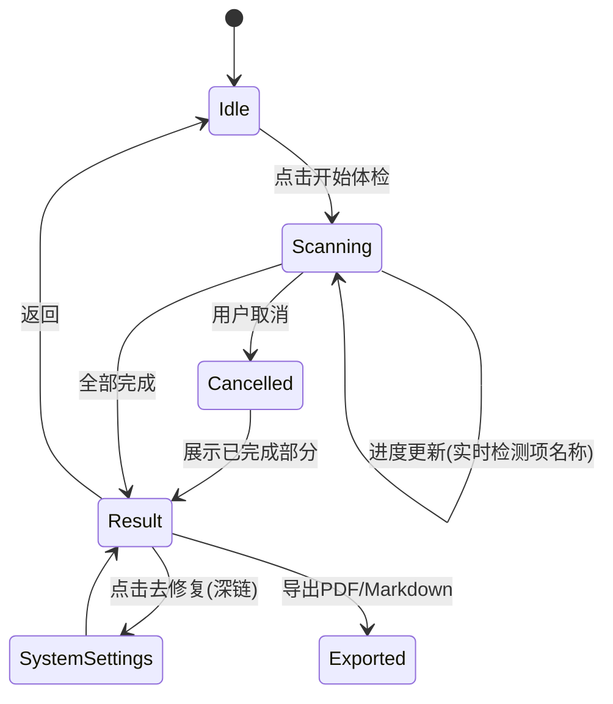

# 开发设计文档：安全盾 SafeShield（macOS 安全防护软件）

> 承接 PRD，给出可直接进入编码阶段的技术设计：分层架构、模块契约、核心接口代码骨架、评分算法、数据模型、并发模型、双轨能力裁剪与工程化方案。
>
> **修订说明（V2.0，整合版）**：依据 `00-安全盾SafeShield-整合版总方案.md` 修订。产品由"一次性体检"扩展为**"体检 + 持续守护"双引擎**，因此本设计新增：**① 持续检测器（ContinuousDetector）与守护引擎（GuardianEngine）**、**② 基线状态存储（BaselineStore）**、**③ 处置/动作框架（ResponseCoordinator + ActionPolicy + 审计 + 回滚）**、**④ root 特权助手（PrivilegedHelper via SMAppService + XPC）**。本机既有 `monitor.py` 的差分检测逻辑作为持续检测器的算法蓝本移植（见 §16 映射表）。同时修正了原设计的若干问题：ProcessRunner 白名单补齐端口枚举命令并说明全量需走特权助手（§9.1）、EndpointSecurity 定位修正（§9.4）、`detectoID` 拼写、离线版本比对方案。

---

## 1. 技术栈与工程基线

| 项 | 选型 | 说明 |
|---|---|---|
| 语言 | Swift 5.10+，启用 Strict Concurrency（`-strict-concurrency=complete`） | 编译期消除数据竞争 |
| UI | SwiftUI（主窗口）+ AppKit（菜单栏 `MenuBarExtra`、深链跳转） | 最低 macOS 14 |
| 并发 | Swift Concurrency（`async/await`、`TaskGroup`、`Actor`、`AsyncSequence`） | 检测器并发调度；守护模式的周期/事件流 |
| 持久化 | SwiftData（报告 + 基线 + 审计）+ Keychain（配置密钥）+ JSON（规则库） | 报告/规则/基线分离 |
| 常驻调度 | `DispatchSourceTimer` / `Task` 循环（utility QoS）+ 可选 EndpointSecurity 事件流 | 守护模式周期或事件驱动 |
| 特权能力 | `SMAppService` 注册 root **特权助手** + `NSXPCConnection`（校验调用方签名） | 全量端口/连接采集、处置执行；仅完整版 |
| 依赖管理 | Swift Package Manager，零三方运行时依赖 | 供应链最小化 |
| 构建 | Xcode 16 + 双 Target（`SafeShield-AppStore` / `SafeShield-Direct`）+ 共享 Framework + **特权助手 Target（仅 Direct）** | 见 §8 双轨策略 |
| 签名 | Hardened Runtime + 公证（notarytool）+ App Sandbox（仅 Store Target） | entitlements 分文件管理 |
| CI | Xcode Cloud / GitHub Actions + swiftlint + swiftformat + 单测覆盖率门禁 | 覆盖率 ≥ 70% |

---

## 2. 分层架构

```mermaid
flowchart TB
    subgraph L1["表现层 Presentation"]
        UI1[DashboardView<br/>评分环+实时告警流]
        UI2[GuardianCenterView<br/>事件时间线/处置确认]
        UI3[ReportCenterView<br/>历史趋势]
        UI4[SettingsView/隐私中心]
        UI5[MenuBarController]
    end
    subgraph L2["应用层 Application"]
        VM["ScanViewModel / GuardianViewModel"]
        CO[ScanCoordinator<br/>体检编排 Actor]
        GC[GuardianCoordinator<br/>守护编排 Actor]
        RC[ResponseCoordinator<br/>处置编排+审计+回滚]
        RM[RemediationRouter<br/>深链跳转]
    end
    subgraph L3["领域层 Domain"]
        SE[ScanEngine<br/>快照调度+超时+取消]
        GE[GuardianEngine<br/>周期/事件调度+差分]
        RE[RuleEngine<br/>分级+评分+告警级别]
        REG[DetectorRegistry<br/>snapshot/continuous]
        CAP[CapabilityProbe<br/>能力探测]
        AP[ActionPolicy<br/>处置门控/授权]
        BSL[BaselineStore<br/>基线状态]
    end
    subgraph L4["检测器层 Detectors"]
        D1[快照检测器 ×6<br/>SystemConfig/Privacy/Persistence<br/>FileIntegrity/Network/Account]
        D2[持续检测器 ×6<br/>ProcessBehavior/NetworkConnection<br/>PortBaseline/FileIntegrityMonitor<br/>PersistenceMonitor/AccountMonitor]
    end
    subgraph L5["基础设施层 Infrastructure"]
        S1[SystemInfoGateway]
        S2[SecurityFrameworkGateway]
        S3[ProcessRunner<br/>白名单命令]
        S4[PrivilegedHelper XPC<br/>root 采集+处置执行]
        S5[HashService]
        S6[ThreatIntelClient<br/>TLS+证书固定]
        S7[ReportStore/BaselineStore/AuditLog]
        S8[Logger/OSLog]
    end
    L1 --> L2 --> L3 --> L4 --> L5
```



**依赖规则**：上层只能依赖下层协议，检测器不得直接 import SwiftUI；基础设施层通过协议注入（便于单测 Mock）。所有跨层调用使用协议抽象 + 依赖注入容器 `AppEnvironment`。

---

## 3. 目录结构

```
SafeShield/
├── App/                      # 入口、AppEnvironment、双 Target 配置
├── PrivilegedHelper/         # root 特权助手 Target（仅 Direct）：全量采集 + 处置执行
├── Presentation/
│   ├── Dashboard/ Guardian/ Report/ Settings/ MenuBar/
├── Application/              # ViewModel、ScanCoordinator、GuardianCoordinator、ResponseCoordinator、RemediationRouter
├── Domain/
│   ├── Models/               # Finding, Event, Severity, Action, ScanReport, Score, Baseline
│   ├── Engine/               # ScanEngine, GuardianEngine, RuleEngine, DetectorRegistry, ActionPolicy
│   └── Protocols/            # SnapshotDetector, ContinuousDetector, Gateway 协议定义
├── Detectors/
│   ├── Snapshot/             # SystemConfig/ Privacy/ Persistence/ FileIntegrity/ Network/ Account
│   └── Continuous/           # ProcessBehavior/ NetworkConnection/ PortBaseline/ FileIntegrityMonitor/ PersistenceMonitor/ AccountMonitor
├── Infrastructure/
│   ├── System/ Security/ Crypto/ Network/ Storage/ Logging/
│   ├── Privileged/           # PrivilegedHelperClient (XPC)
│   ├── Baseline/             # BaselineStore
│   └── Audit/                # AuditLog
├── Rules/                    # rules.default.json（体检 + 守护规则）+ 规则 Schema
├── Resources/                # Localizable、Assets、PrivacyInfo.xcprivacy
└── Tests/
    ├── UnitTests/ IntegrationTests/ SnapshotTests/
```

---

## 4. 核心领域模型

```swift
// MARK: - 风险等级与检测项
public enum Severity: Int, Codable, Comparable, Sendable {
    case info = 0, low = 1, medium = 2, high = 3, critical = 4
    public static func < (l: Self, r: Self) -> Bool { l.rawValue < r.rawValue }
}

public enum Dimension: String, Codable, CaseIterable, Sendable {
    case systemConfig, privacy, persistence, fileIntegrity, network, account
}

public struct Finding: Identifiable, Codable, Sendable {
    public let id: UUID
    public let ruleID: String            // 如 "SYS-FILEVAULT-001"
    public let dimension: Dimension
    public let title: String             // 通俗标题
    public let detail: String            // 风险说明
    public let severity: Severity
    public let status: FindingStatus     // passed / risk / unavailable / skipped
    public let remediation: Remediation? // 修复引导
    public let evidence: [String: String]// 可展示证据（非敏感）
    public let detectedAt: Date
}

public enum FindingStatus: String, Codable, Sendable {
    case passed, risk, unavailable   // 能力受限无法检测
    case skipped, error
}

public struct Remediation: Codable, Sendable {
    public let kind: Kind            // deepLink / manualGuide / externalURL
    public let target: String        // x-apple.systempreferences:com.apple.preference.security?FDE
    public let steps: [String]
    public enum Kind: String, Codable { case deepLink, manualGuide, externalURL }
}
```

**设计要点**：`Finding` 是检测器与 UI 之间唯一的契约。`evidence` 强制为字符串字典且禁止放入口令、文件内容等敏感数据，由代码审查规约 + 单测校验。`unavailable` 状态是双轨版本的关键，UI 需展示"当前版本不支持，原因…"而非"检测失败"。

### 4.1 守护模式领域模型（新增）

守护模式产出的是**运行时事件（Event）**而非静态 Finding。Event 可携带"建议处置动作"，但动作是否执行由 `ActionPolicy` + 用户确认决定，检测器本身**永不触发处置**。

```swift
// MARK: - 检测器类型：快照 vs 持续
public enum DetectorKind: String, Codable, Sendable { case snapshot, continuous }

// MARK: - 运行时事件（守护模式）
public struct SecurityEvent: Identifiable, Codable, Sendable {
    public let id: UUID
    public let ruleID: String                 // 如 "GARD-PROC-MINER"
    public let dimension: Dimension
    public let kind: EventKind                // 见下
    public let title: String
    public let detail: String
    public let severity: Severity
    public let evidence: [String: String]     // 脱敏：pid、命令行片段、端口、哈希等
    public let suggestedActions: [Action]     // 建议动作，需用户确认（可为空）
    public let detectedAt: Date
}

public enum EventKind: String, Codable, Sendable {
    case suspiciousProcess, newListenPort, publicConnection,
         highFreqConnection, suspiciousPortConnection,
         newPersistenceItem, newFile, fileTampered, newLocalUser
}

// MARK: - 处置动作（检测与响应分离的核心）
public struct Action: Identifiable, Codable, Sendable {
    public let id: UUID
    public let type: ActionType
    public let target: ActionTarget           // pid / filePath / ip
    public let reason: String                 // 触发规则与依据
    public let reversible: Bool               // kill=false, quarantine/block=true
    public let requiresConfirm: Bool          // kill/block 恒为 true
}

public enum ActionType: String, Codable, Sendable {
    case killProcess, quarantineFile, blockIP, none
}

public enum ActionTarget: Codable, Sendable {
    case process(pid: Int32, cmdline: String)
    case file(path: String, hash: String)
    case ip(String)
}

// MARK: - 处置姿态（对应 PRD F11-1）
public enum ResponsePosture: String, Codable, Sendable {
    case readOnly            // 只告警，不提供处置
    case confirm             // 默认：逐项/批量确认后执行
    case semiAuto            // 仅可逆动作按一次性授权策略自动执行并通知
}
```

**设计要点**：`SecurityEvent.suggestedActions` 只是"建议"，`ResponseCoordinator` 是唯一有权执行处置的组件，且必经 `ActionPolicy` 门控（姿态、白名单、能力探测、用户确认）。`Action.reversible` 与 `requiresConfirm` 由动作类型静态决定，UI 对不可逆动作用醒目样式并二次确认。

### 4.2 基线状态模型（新增）

守护模式的差分依赖基线（移植自 monitor.py 的 `state.json`），但结构化、可修剪、可持久化：

```swift
public struct Baseline: Codable, Sendable {
    var knownPorts: Set<Int> = []
    var knownFiles: [String: String] = [:]      // path -> sha256
    var knownPersistenceItems: Set<String> = [] // LaunchAgents/Daemons 名称
    var knownUsers: Set<String> = []
    var establishedAt: Date?
}
```

**首次运行建立基线不误报**：`establishedAt == nil` 时，本轮只记录基线、不产生差分告警（对应 monitor.py 中 `known_users`/`known_ports` 首轮仅初始化的逻辑）。体检模式产出的快照可用于**初始化/校准**基线，两模式天然衔接。

---

## 5. 检测器契约与注册机制

```swift
// MARK: - 检测器协议
public protocol Detector: Sendable {
    /// 稳定唯一标识，用于注册表与规则匹配
    static var id: String { get }
    /// 所属维度
    static var dimension: Dimension { get }
    /// 预估耗时（用于调度分组与进度条权重）
    static var cost: DetectorCost { get }
    /// 运行前声明所需能力；不满足则整体降级为 .unavailable
    static var requiredCapabilities: Set<Capability> { get }

    /// 执行检测。必须响应 cancellation；禁止阻塞主线程；禁止任何写操作。
    func detect(context: ScanContext) async throws -> [Finding]
}

public enum DetectorCost: Sendable { case fast, medium, heavy }

// MARK: - 持续检测器协议（守护模式，新增）
/// 与快照检测器共享 id/dimension/cost/requiredCapabilities，但产出的是"相对基线的差分事件"。
/// 契约红线：observe 必须只读，禁止在检测器内直接执行任何处置动作（处置只由 ResponseCoordinator 负责）。
public protocol ContinuousDetector: Sendable {
    static var id: String { get }
    static var dimension: Dimension { get }
    static var cost: DetectorCost { get }
    static var requiredCapabilities: Set<Capability> { get }

    /// 采集当前运行时状态，与 baseline 差分，产出事件。必须响应 cancellation。
    /// 返回 (本轮事件, 需要写回基线的增量)。基线写回由 GuardianEngine 统一持久化，检测器不直接写。
    func observe(baseline: Baseline, context: ScanContext) async throws -> (events: [SecurityEvent], baselineDelta: BaselineDelta)
}

public struct BaselineDelta: Sendable {
    var addedPorts: Set<Int> = []
    var removedPorts: Set<Int> = []
    var fileHashes: [String: String] = [:]
    var addedPersistenceItems: Set<String> = []
    var addedUsers: Set<String> = []
}

public struct ScanContext: Sendable {
    let capabilityProbe: CapabilityProbing
    let ruleEngine: RuleEvaluating
    let threatIntel: ThreatIntelQuerying?   // 仅用户开启云查杀时非 nil
    let secrets: SecretProviding            // Keychain 只读封装
    let logger: Logger
}

// MARK: - 注册表（编译期 + 运行期能力过滤，双类型）
public actor DetectorRegistry {
    private var snapshotDetectors: [any Detector] = []
    private var continuousDetectors: [any ContinuousDetector] = []

    public func register(_ detector: any Detector) { snapshotDetectors.append(detector) }
    public func register(_ detector: any ContinuousDetector) { continuousDetectors.append(detector) }

    /// 体检模式：按渠道与实际授权过滤出可运行的快照检测器
    public func resolveSnapshot(probe: CapabilityProbing) async -> [any Detector] {
        snapshotDetectors.filter { d in d.requiredCapabilities.allSatisfy { await probe.has($0) } }
    }
    public func resolveSnapshotUnavailable(probe: CapabilityProbing) async -> [any Detector] {
        snapshotDetectors.filter { d in !d.requiredCapabilities.allSatisfy { await probe.has($0) } }
    }

    /// 守护模式：过滤出可运行的持续检测器
    public func resolveContinuous(probe: CapabilityProbing) async -> [any ContinuousDetector] {
        continuousDetectors.filter { d in d.requiredCapabilities.allSatisfy { await probe.has($0) } }
    }
}
```

**新增检测项的成本**：实现 `Detector`（快照）或 `ContinuousDetector`（持续）→ 在 `rules.default.json` 中补充规则条目 → 在 `Registration+Default.swift` 中 `register`。核心引擎、UI、评分逻辑均无需修改。

---

## 6. 扫描调度引擎

```swift
public actor ScanEngine {
    private let registry: DetectorRegistry
    private var currentTask: Task<Void, Never>?

    public func startScan(probe: CapabilityProbing,
                          progress: @Sendable @escaping (ScanProgress) -> Void) async -> ScanReport {
        await withTaskCancellationHandler {
            let runnables = await registry.resolveSnapshot(probe: probe)
            let unavailable = await registry.resolveSnapshotUnavailable(probe: probe)

            // 分组：fast 并发不限，heavy 限制并发 2，避免 CPU 抢占前台
            var findings: [Finding] = []
            let total = Double(runnables.reduce(0) { $0 + $1.cost.weight })

            await withTaskGroup(of: [Finding].self) { group in
                for detector in runnables {
                    group.addTask { [progress] in
                        await Self.runIsolated(detector, probe: probe, progress: progress)
                    }
                }
                for await batch in group { findings.append(contentsOf: batch) }
            }

            // 能力不足项生成 .unavailable 占位 Finding
            findings += unavailable.map { Finding.unavailablePlaceholder(for: $0) }

            return ScanReport(findings: findings, score: RuleEngine.score(findings),
                              finishedAt: .now, buildChannel: BuildInfo.channel)
        } onCancel: { currentTask?.cancel() }
    }

    /// 隔离执行：超时、崩溃防护、日志埋点
    private static func runIsolated(_ d: any Detector, probe: CapabilityProbing,
                                    progress: @Sendable @escaping (ScanProgress) -> Void) async -> [Finding] {
        do {
            return try await withThrowingTaskGroup(of: [Finding].self) { group in
                group.addTask { try await d.detect(context: .live(probe: probe)) }
                group.addTask {
                    try await Task.sleep(for: .seconds(d.cost.timeout))
                    throw ScanError.timeout(detectorID: type(of: d).id)
                }
                guard let first = try await group.next() else { return [] }
                group.cancelAll()
                return first
            }
        } catch {
            Logger.detector.error("\(type(of: d).id) failed: \(error.localizedDescription)")
            return [Finding.error(for: type(of: d).id, error: error)]
        }
    }
}
```

**调度约束**：

- 所有 `heavy` 检测器（如 Downloads 目录遍历、哈希计算）使用 `.utility` QoS，避免与前台争抢；
- 取消采用协作式：检测器内部循环必须检查 `Task.checkCancellation()`，长耗时 IO 分批让出；
- 单个检测器失败不影响整体，降级为 `error` 状态并计入"未完成"提示。

### 6.1 守护引擎 GuardianEngine（新增）

守护引擎以固定周期（默认 60s，可配）或事件驱动（完整版可选 EndpointSecurity）运行持续检测器，做基线差分并把事件推给告警流。它**只产出事件、绝不执行处置**——处置由 `ResponseCoordinator` 在用户确认后另行处理。

```swift
public actor GuardianEngine {
    private let registry: DetectorRegistry
    private let baselineStore: BaselineStoring
    private var loopTask: Task<Void, Never>?

    /// 启动守护循环（utility QoS，长期常驻）
    public func start(probe: CapabilityProbing,
                      interval: Duration = .seconds(60),
                      onEvent: @Sendable @escaping (SecurityEvent) -> Void) {
        loopTask?.cancel()
        loopTask = Task.detached(priority: .utility) { [weak self] in
            guard let self else { return }
            while !Task.isCancelled {
                await self.runOneCycle(probe: probe, onEvent: onEvent)
                try? await Task.sleep(for: interval)
            }
        }
    }

    public func stop() { loopTask?.cancel(); loopTask = nil }

    private func runOneCycle(probe: CapabilityProbing,
                             onEvent: @Sendable @escaping (SecurityEvent) -> Void) async {
        var baseline = await baselineStore.load()
        let isFirstRun = baseline.establishedAt == nil      // 首轮只建基线，不误报
        let detectors = await registry.resolveContinuous(probe: probe)

        await withTaskGroup(of: (events: [SecurityEvent], delta: BaselineDelta)?.self) { group in
            for d in detectors {
                group.addTask {
                    // 单检测器隔离：超时 + 崩溃防护，失败不影响整轮
                    guard let r = try? await Self.observeIsolated(d, baseline: baseline, probe: probe) else { return nil }
                    return r
                }
            }
            for await result in group {
                guard let result else { continue }
                baseline = baseline.applying(result.delta)   // 合并增量
                if !isFirstRun { result.events.forEach(onEvent) }
            }
        }

        baseline.establishedAt = baseline.establishedAt ?? .now
        await baselineStore.save(prune(baseline))            // 修剪后持久化，防膨胀
    }

    private static func observeIsolated(_ d: any ContinuousDetector, baseline: Baseline,
                                        probe: CapabilityProbing) async throws -> (events: [SecurityEvent], delta: BaselineDelta) {
        try await withThrowingTaskGroup(of: (events: [SecurityEvent], delta: BaselineDelta).self) { group in
            group.addTask { try await d.observe(baseline: baseline, context: .live(probe: probe)) }
            group.addTask {
                try await Task.sleep(for: .seconds(d.cost.timeout))
                throw ScanError.timeout(detectorID: type(of: d).id)
            }
            guard let first = try await group.next() else { throw ScanError.timeout(detectorID: type(of: d).id) }
            group.cancelAll()
            return first
        }
    }
}
```

**守护调度约束**：

- **基线修剪**：每轮持久化前修剪（移除已不存在文件的哈希、截断过长列表），移植自 monitor.py `prune_state`，防止 `state.json` 式膨胀；
- **首轮建基线**：`establishedAt == nil` 时不产生差分告警，避免冷启动误报风暴；
- **低占用**：整轮以 `.utility` QoS 运行，重活（目录遍历/哈希）惰性分批 `Task.yield()`；
- **告警抑制**：同类事件在短时间内去重，避免通知风暴（对应 monitor.py 的通知限长/限频思路）。

---

## 6.2 处置编排 ResponseCoordinator 与 ActionPolicy（新增）

这是"检测-响应分离"的落点：**唯一有权执行处置的组件**，所有动作必经姿态门控 + 白名单校验 + 能力探测 + 用户确认，执行后写审计、登记可回滚句柄。

```swift
public actor ResponseCoordinator {
    private let policy: ActionPolicy
    private let helper: PrivilegedHelpering?   // 无特权助手（沙盒版）时为 nil → 一律降级引导
    private let audit: AuditLogging
    private let rollbackRegistry: RollbackRegistry

    /// UI 层在用户确认后调用。returns 处置回执
    public func execute(_ action: Action, authorization: UserAuthorization) async -> ActionReceipt {
        // 1) 策略门控：姿态是否允许、是否白名单目标、能力是否具备
        guard policy.allows(action, posture: authorization.posture) else {
            return .denied(reason: "policy")
        }
        // 2) 确认门控：kill/block 恒需逐项确认；不可逆动作需二次确认
        guard action.requiresConfirm == false || authorization.confirmedActionIDs.contains(action.id) else {
            return .needsConfirmation
        }
        // 3) 特权执行（结构化指令，非 shell 字符串）
        guard let helper else { return .degradedToGuidance }
        do {
            let handle = try await helper.perform(action)     // kill / block / quarantine
            try? rollbackRegistry.register(action, handle)     // 可逆动作登记回滚句柄
            audit.append(.init(action: action, authorization: authorization, result: .success))
            return .success(handle: handle, reversible: action.reversible)
        } catch {
            audit.append(.init(action: action, authorization: authorization, result: .failure("\(error)")))
            return .failed("\(error)")
        }
    }

    /// 回滚：还原隔离文件 / 解除 IP 封禁（kill 不可回滚）
    public func rollback(_ handle: RollbackHandle) async -> ActionReceipt { /* ... */ }
}

public struct ActionPolicy {
    let posture: ResponsePosture
    let whitelist: WhitelistSet                 // 通用规则 + 用户本地学习白名单

    func allows(_ action: Action, posture: ResponsePosture) -> Bool {
        if posture == .readOnly { return false }
        if whitelist.contains(action.target) { return false }   // 命中白名单永不处置
        switch posture {
        case .confirm:  return true                              // 仍需上层确认门控
        case .semiAuto: return action.reversible                 // 半自动仅允许可逆动作自动执行
        case .readOnly: return false
        }
    }
}
```

**处置红线（与 PRD F11 / 合规红线一致）**：

- `killProcess`、`blockIP` **永远 `requiresConfirm = true`**，即便 semiAuto 也不自动执行；
- `quarantineFile` 可逆（隔离区可还原），semiAuto 下可按一次性授权策略自动执行并即时通知；
- 命中白名单的目标**永不处置**（对应 monitor.py `is_*_whitelisted` 前置判断，且 `block_ip` 对白名单 IP 直接跳过）；
- 无特权助手（App Store 版）时，一切处置降级为引导（`.degradedToGuidance`）。

---

## 7. 规则引擎与评分算法

规则与代码解耦，`rules.default.json` 结构：

```json
{
  "version": 3,
  "rules": [
    {
      "id": "SYS-FILEVAULT-001",
      "dimension": "systemConfig",
      "weight": 18,
      "condition": { "key": "fileVaultStatus", "op": "eq", "value": "off" },
      "severity": "critical",
      "titleKey": "rule.filevault.off.title",
      "detailKey": "rule.filevault.off.detail",
      "remediation": {
        "kind": "deepLink",
        "target": "x-apple.systempreferences:com.apple.preference.security?Privacy_FileVault"
      }
    }
  ]
}
```

**评分公式**（维度分 → 加权总分）：

```
S_dim = 100 × (1 - Σ(w_i · p_sev(i)) / Σ(w_i))   对所有 i ∈ dim
```

其中惩罚系数 `p` 取值：critical = 1.0，high = 0.6，medium = 0.3，low = 0.1，info = 0；`unavailable` 项从分母中剔除，不参与扣分也不参与满分计算。

```
S_total = Σ(S_dim · α_dim),  Σα_dim = 1
```

默认维度权重：系统配置 0.25、隐私 0.20、启动项 0.20、文件 0.15、网络 0.10、账户 0.10。

**确定性要求**：同一系统状态下重复体检必须产出完全一致的分数（单测断言），因此规则库需带 `version`，报告持久化时记录规则版本号，历史对比时提示"规则库已更新，分数口径变化"。

**离线版本比对（对应 PRD F2-6）**：系统"版本落后"判定不实时联网，而是随规则库分发一份**"已知最新补丁表"**（`latestPatchTable`，含各大版本当前最新安全补丁号，带 `asOf` 日期）；`SystemConfigDetector` 用 `sw_vers` 读到的本机版本与该表离线比对，联网仅用于静默刷新此表。这样既满足"全程无网络可完成基础体检"，又保持判定可复现（表版本计入 `ruleSetVersion`）。

### 7.1 守护规则（新增）

守护模式复用同一规则引擎，但规则条目描述的是**运行时差分条件 + 告警级别 + 建议动作**，不参与体检评分（评分只反映配置卫生）。守护规则由 monitor.py 的 `config.json` 通用化而来（关键字、可疑端口、监控路径），随产品发布并可热更新；**用户/企业专属白名单单独存本地、不进产品包**。

```json
{
  "id": "GARD-PROC-MINER",
  "dimension": "persistence",
  "kind": "continuous",
  "match": { "type": "cmdlineContainsAny", "values": ["xmrig", "minerd", "stratum", "cryptonight"] },
  "severity": "high",
  "titleKey": "guard.process.miner.title",
  "suggestedActions": ["killProcess"],
  "reversible": false
}
```

```json
{
  "id": "GARD-NET-SUSPORT",
  "dimension": "network",
  "kind": "continuous",
  "match": { "type": "establishedToPortAny", "values": [22, 23, 445, 3389, 5900, 4444, 5555, 6666, 8888], "minCount": 3 },
  "severity": "high",
  "suggestedActions": ["blockIP"],
  "reversible": true
}
```

`suggestedActions` 只是建议，是否可执行、是否需确认由 `ActionPolicy` 与动作类型的静态属性决定（见 §6.2）；规则文件不能绕过确认门控。

---

## 8. 双轨能力裁剪（CapabilityProbe）

```swift
public enum Capability: String, Sendable {
    case fullDiskAccess, systemDaemonEnumeration, listeningPorts,
         tccDatabaseRead, networkInterfaceDetail, appleEvents,
         privilegedHelper          // 新增：root 特权助手已安装且已授权
}

public protocol CapabilityProbing: Sendable {
    func has(_ c: Capability) async -> Bool
    func request(_ c: Capability) async -> CapabilityRequestResult
}

public actor CapabilityProbe: CapabilityProbing {
    private var cache: [Capability: Bool] = [:]
    public let channel: BuildChannel     // .appStore / .developerID

    public func has(_ c: Capability) async -> Bool {
        if let hit = cache[c] { return hit }
        let result: Bool
        switch c {
        case .fullDiskAccess:
            // 运行时探测：尝试读取受保护路径的元数据（只读、失败即无权限）
            result = FileManager.default.isReadableFile(atPath: ProbePath.tccDB)
        case .tccDatabaseRead:
            result = channel == .developerID && await has(.fullDiskAccess)
        case .listeningPorts:
            // 全量端口/连接可见性依赖特权助手；无助手时仅当前用户可见范围（UI 需标注降级）
            result = channel == .developerID && await has(.privilegedHelper)
        case .systemDaemonEnumeration:
            result = channel == .developerID
        case .privilegedHelper:
            // 仅完整版可安装 SMAppService 特权助手，且用户已授权、XPC 连通
            result = channel == .developerID && await PrivilegedHelperClient.isConnectedAndAuthorized()
        case .networkInterfaceDetail, .appleEvents:
            result = true
        }
        cache[c] = result
        return result
    }

    /// 引导用户授权：只跳转系统设置，绝不代替用户修改
    public func request(_ c: Capability) async -> CapabilityRequestResult {
        RemediationRouter.openSystemSettings(for: c)
        return .awaitingUserAction
    }
}
```

**共享代码策略**：`Domain`、`Detectors`、`Infrastructure` 全部放入 `SafeShieldCore` Framework，两个 App Target 只包含入口与 entitlements 差异。渠道信息通过 `BuildInfo.channel`（编译宏 `APPSTORE_BUILD`）注入，运行时二次探测实际授权状态——**编译期决定"能不能"，运行期决定"有没有"**。

---

## 9. 基础设施关键实现要点

### 9.1 ProcessRunner（白名单命令执行）

```swift
public actor ProcessRunner {
    /// 仅允许白名单内的只读命令，参数固定不接受用户输入拼接
    /// 注意：Process.executableURL 不做 PATH 解析，必须写真实绝对路径
    /// （spctl 在 /usr/sbin、socketfilterfw 在 /usr/libexec/ApplicationFirewall，
    ///   写成 /usr/bin 会在运行时抛 "file doesn't exist" 并被误判为检测失败）
    private static let allowed: Set<String> = [
        "/usr/bin/csrutil", "/usr/bin/fdesetup", "/usr/sbin/spctl",
        "/usr/libexec/ApplicationFirewall/socketfilterfw",
        "/usr/sbin/system_profiler", "/bin/launchctl", "/usr/bin/defaults",
        "/usr/sbin/sysctl", "/usr/bin/sw_vers", "/usr/bin/dscl",
        // 端口/连接枚举：非特权下仅见当前用户 socket；全量需走 §9.1b 特权助手
        "/usr/sbin/lsof", "/usr/bin/netstat"
    ]
    public func run(_ tool: String, args: [String]) async throws -> CommandOutput {
        guard Self.allowed.contains(tool) else { throw InfraError.notWhitelisted }
        guard args.allSatisfy({ !$0.contains(";") && !$0.contains("|") })
              else { throw InfraError.invalidArgument }
        // /usr/bin/exec 直调，不经过 shell，杜绝注入
        ...
    }
}
```

必须使用 `Process` 直接执行二进制而非 `sh -c`，从根本上消除命令注入面。**注意**：`lsof -i`/`netstat` 在非特权进程下只能看到当前用户拥有的 socket，看不到 root 守护进程的端口与连接——这是 monitor.py 以 LaunchAgent（用户态）运行时的固有盲区。全量枚举必须通过 §9.1b 的特权助手采集，`NetworkSurfaceDetector`/`NetworkConnectionDetector` 据 `Capability.listeningPorts` 决定走助手还是降级。

### 9.1b PrivilegedHelper（root 特权助手，新增，仅完整版）

用 `SMAppService.daemon` 注册一个 root 权限的 XPC 助手，承担两件事：**全量采集**与**处置执行**。

- **注册与授权**：主 App 调用 `SMAppService.daemon(plistName:).register()`，首次触发系统授权（admin）；用户可随时在设置里 `unregister()` 撤销，撤销后不再有任何后台特权进程；
- **XPC 安全**：`NSXPCConnection` 设置 `codeSigningRequirement`，只接受本 App 团队签名 + 指定 bundle id 的连接，防止其他进程冒用；
- **采集接口**：`fetchListeningPorts() / fetchEstablishedConnections() / fetchProcessList()`，助手内以 root 运行 lsof/netstat/proc 并回传结构化数据（非原始文本），补齐非特权盲区；
- **执行接口**：`perform(Action) -> RollbackHandle`，只接受结构化 `Action`（枚举 + 强类型 target），助手侧再做一次白名单与参数校验后执行 `kill` / `pfctl block` / 文件隔离，返回可用于回滚的句柄；
- **最小权限**：助手不常驻轮询、不主动做任何事，只在收到 XPC 指令时执行一次并返回；**绝不接受 shell 字符串**，杜绝注入；
- **隔离与稳定性**：助手崩溃由 launchd 自动重启，不影响主 App UI（对应原 §14 的 XPC 隔离预案）。

### 9.1c BaselineStore 与 AuditLog（新增）

- **BaselineStore**：守护模式基线（端口/文件哈希/启动项/用户）的持久化，移植自 monitor.py 的 `state.json`，但结构化并在每轮写入前**修剪**（移除已删除文件的哈希、截断超长列表），避免无限膨胀；文件位于 App 沙盒容器/用户容器内。
- **AuditLog**：处置审计日志，**只追加、普通流程不可改写**，记录 `{动作, 目标, 触发规则/事件, 时间, 授权方式, 结果}`，支持查看与导出，是"检测-响应分离"合规性的证据链。

### 9.2 ThreatIntelClient（云查杀）

- 仅上传 SHA-256 哈希，请求体不包含文件名、路径、内容；
- 使用 `URLSession` 自定义 `delegate` 实现证书固定（SPKI hash 比对）；
- 请求速率限制（本地令牌桶），失败退避重试；
- 开关默认关闭，首次开启弹窗明示数据流向，记录用户同意时间戳；
- 响应结果缓存于本地，TTL 7 天，减少重复外发。

### 9.3 隐私合规

必须提供 `PrivacyInfo.xcprivacy`，如实声明 Required Reason API 使用（`NSFileManager` 磁盘空间、`UserDefaults`、系统启动时间等），并声明不收集任何用户数据（Data Collection = None）或仅哈希查询。这是 App Store 审核的硬门槛。

### 9.4 EndpointSecurity 定位修正（重要）

原方案曾把 EndpointSecurity 描述为"只读评估"接口，**这是误解**：ES 是实时**事件流**框架（`ES_EVENT_TYPE_NOTIFY_*` / `AUTH_*`），需要 Apple 专项审批的 `com.apple.developer.endpoint-security.client` entitlement，且**在 App Store 沙盒版中根本不可用**，还必须关闭 App Sandbox 才能运行。整合版定位如下：

- **完整版可选增强**：若申请到 ES entitlement，用它做真实时的进程 exec / 文件写入事件驱动，替代轮询差分，降低延迟与 CPU 占用；
- **默认退化路径**：拿不到 ES 时（大多数情况），守护模式退化为**轮询快照差分**（即 monitor.py 的既有方式：定期采集 + 与基线比对），功能完整、只是实时性略低；
- **App Store 版**：不使用 ES；
- 因此 ES 是"锦上添花"而非架构依赖，M0 阶段验证其可申请性，但**不阻塞**主体开发。

---

## 10. 数据模型（SwiftData）

```swift
@Model
public final class ScanReportRecord {
    @Attribute(.unique) public var id: UUID
    public var totalScore: Int
    public var dimensionScores: [String: Int]
    public var criticalCount: Int
    public var highCount: Int
    public var ruleSetVersion: Int
    public var buildChannel: String
    public var createdAt: Date
    @Relationship(deleteRule: .cascade) public var findings: [FindingRecord]
}

@Model
public final class FindingRecord {
    public var ruleID: String
    public var severityRaw: Int
    public var statusRaw: String
    public var title: String
    public var detail: String
    public var remediationTarget: String?
    public var evidenceJSON: String      // 已脱敏
}

// MARK: - 守护事件与处置审计（新增）
@Model
public final class SecurityEventRecord {
    @Attribute(.unique) public var id: UUID
    public var ruleID: String
    public var kindRaw: String
    public var severityRaw: Int
    public var title: String
    public var detail: String
    public var evidenceJSON: String      // 已脱敏
    public var detectedAt: Date
    public var resolved: Bool            // 是否已处置/已忽略
}

@Model
public final class AuditRecord {
    @Attribute(.unique) public var id: UUID
    public var actionTypeRaw: String     // killProcess / quarantineFile / blockIP
    public var targetJSON: String        // 脱敏后的目标描述
    public var triggerRuleID: String
    public var authorizationRaw: String  // confirm / semiAutoPolicy / secondConfirm
    public var resultRaw: String         // success / failed / denied / rolledBack
    public var reversible: Bool
    public var rollbackHandle: String?   // 用于回滚（隔离路径 / pfctl 规则标识）
    public var createdAt: Date
}
```

**保留策略**：体检报告默认保留最近 50 份，超出按 FIFO 删除；守护事件按时间窗口（默认 30 天）滚动清理；**审计日志保留期更长（默认 180 天）且不可被普通流程改写**，用户可在设置中一键清空全部本地数据。数据库文件位于沙盒容器内，不加密（因已在用户账户保护下），但导出 PDF 时提示用户"报告包含系统配置信息"。

---

## 11. UI 关键设计



- **仪表盘**：顶部评分环（`Gauge` 自定义样式）+ 六个维度小环；下方风险列表按 severity 降序，`unavailable` 项折叠到"本次未检测（N 项）"分组，展开说明原因与升级引导；**并列展示守护模式的实时告警时间线（最近 N 条 + 活跃高危数）**；
- **守护中心**：运行时事件时间线（进程/网络/启动项/文件/账户），每条高危事件附"建议动作"与**确认处置**入口；不可逆动作（kill/block）用醒目样式并二次确认；内置隔离区（可还原/彻底删除）、封禁列表（可解除）、审计日志查看与导出；
- **修复引导**：每条风险右侧主按钮"去修复"，触发 `RemediationRouter` 深链跳转 `x-apple.systempreferences:`；无深链可用时展示图文步骤（本地化 Markdown 渲染）；
- **菜单栏**：`MenuBarExtra` 展示最近状态色点（取体检与守护最严重者）+ 快速体检入口 + 守护开关 + 高危项/活跃告警数量；
- **首次引导**：分页说明产品能力边界、需要的权限及原因、隐私承诺；完整版在需要守护/处置时才请求完全磁盘访问与特权助手授权，并解释用途与撤销方式。

---

## 12. 可测试性设计

| 层级 | 策略 |
|---|---|
| 检测器单测 | 所有 Gateway 协议化，注入 Mock。为每个检测器构造"安全态/风险态/不可用态"三组 fixture，断言 Finding 输出与 severity |
| 规则引擎单测 | 表驱动测试，覆盖评分边界（全通过=100、单 critical、全 unavailable、空结果）与确定性（同输入两次结果相等） |
| 集成测试 | 使用 `SnapshotTesting` 对报告页做视图快照；在真实 VM 上验证深链跳转可达 |
| 回归矩阵 | macOS 14/15/26 × Apple Silicon/Intel 共 6 组虚拟机，每次发版跑全量体检脚本比对输出 |
| 隐私审计 | CI 中集成静态扫描：禁止出现 `URLSession` 未在 ThreatIntelClient 内使用、禁止硬编码上传字段 |

---

## 13. 日志与可观测性

统一使用 `OSLog` 分 subsystem/category：`engine`、`detector.<id>`、`infra`、`network`。日志级别：检测失败 `error`、能力降级 `info`、云请求 `debug`。**日志中禁止出现完整文件路径以外的敏感信息**（路径对用户自身有意义，可保留但需脱敏用户名段）。可选支持"导出诊断日志"用于用户反馈问题，导出前弹窗预览内容。

---

## 14. 关键风险的技术预案

| 风险 | 预案 |
|---|---|
| TCC 数据库结构随版本变化 | 只依赖公开 API（`AVCaptureDevice.authorizationStatus`、`ATTrackingManager` 同类），数据库直读仅作为完整版增强且失败自动降级 |
| 沙盒版功能过少导致审核质疑"功能不完整" | 沙盒版聚焦"配置体检 + 文件校验 + 报告中心"，形成独立闭环；不可用项以引导式自查（图文步骤）替代，仍具完整用户价值 |
| 检测器崩溃拖垮主进程 | `ProcessRunner` 子进程隔离 + Swift 层 `try?` 包裹；重活（目录遍历）可下沉到 XPC Service，崩溃自动重启不影响主 UI |
| 深度遍历 Downloads 卡顿 | 使用 `FileManager.enumerator` 惰性遍历 + 每 200 项 `Task.yield()`，进度按文件数上报，支持取消 |

---

## 15. 编码里程碑拆分（M1 六周细化）

| 周次 | 交付 |
|---|---|
| W1 | 工程脚手架、双 Target、CI、`SafeShieldCore` Framework、领域模型与协议定稿 |
| W2 | ScanEngine 调度（并发/超时/取消）+ DetectorRegistry + CapabilityProbe + 全量单测 |
| W3 | SystemConfigDetector 全部 7 项 + RuleEngine 评分 + 规则 JSON v1 |
| W4 | PrivacyPermissionDetector + RemediationRouter 深链矩阵验证 |
| W5 | ReportStore（SwiftData）+ 仪表盘 UI + 报告详情页 + 导出 PDF |
| W6 | 菜单栏、首次引导、设置与隐私中心、公证打包、内测发布 |

---

## 16. monitor.py → Swift 移植映射（守护模式落地索引）

本机既有 `~/mac-security-monitor-skill/monitor.py` 是守护模式的算法蓝本。逐项映射如下，供 M2 阶段直接对照实现：

| monitor.py | Swift 落点 | 备注 |
|---|---|---|
| `state.json`（known_ports/files/launchagents/users） | `BaselineStore` + `Baseline` 模型（§4.2） | 结构化、每轮修剪（对应 `prune_state`） |
| `main()` 每 60s 轮询 | `GuardianEngine.start(interval:)`（§6.1） | utility QoS，可配间隔 |
| `check_processes` + `suspicious_keywords` | `ProcessBehaviorDetector` + `GARD-PROC-*` 规则 | 关键字来自规则文件 |
| 临时目录执行检测（`/tmp`、`/var/folders`） | `ProcessBehaviorDetector` 子规则 | 排除 python/node 的白名单逻辑保留 |
| `check_listen_ports`（新端口差分） | `PortBaselineDetector` + `GARD-NET-PORT` | 全量数据经特权助手 |
| `check_public_connections` / `check_established_connections` | `NetworkConnectionDetector` | 高频阈值、可疑端口列表进规则 |
| `check_watch_paths`（新文件/篡改，SHA-256） | `FileIntegrityMonitor` + `HashService` | 惰性遍历分批 yield |
| `check_launchagents`（新增差分） | `PersistenceMonitor` | 系统级 Daemon 高危 |
| `check_system_accounts`（新增用户） | `AccountMonitor` | 每 N 轮执行一次，可配 |
| `kill_pid` / `block_ip` / `quarantine_file` | `ResponseCoordinator` + `Action`（§4.1/§6.2） | **由自动开关改为确认门控**；经特权助手执行 |
| `is_*_whitelisted`（进程/端口/路径/启动项/IP） | `ActionPolicy.whitelist` + 检测器前置过滤 | 通用规则 + 用户本地学习白名单 |
| `config.json` 白名单清单 | **不进产品包** | 现清单含 本机既有企业安全软件与用户主目录路径，仅对本机有意义 |
| `log_event` / `rotate_log` / stdout 只出告警 | `Logger`(OSLog) + `AuditLog` + 告警流 | 通知限长/限频思路保留 |
| `notify`（osascript）/ `send_wechat_notification` | 系统通知 + 可选外部 webhook（默认关） | 修复过的 AppleScript 转义经验沿用 |

**关键改造点（务必遵守）**：① monitor.py 的 `auto_kill/auto_block/auto_quarantine` 自动处置开关在产品中**默认关闭且不作为默认路径**，改为"确认后处置"；② monitor.py 以 LaunchAgent 用户态运行导致网络可见性盲区与 `sudo pfctl` 失效，产品中由 **root 特权助手**解决；③ 白名单/关键字等**本机专属配置不得硬编码进产品**，须区分"通用可发布规则"与"本地学习白名单"。

---

这套设计把"**插件化双类型检测器 + 规则外置 + 能力/特权门控 + 检测-响应分离**"作为四个核心支点：体检模式防患于未然、守护模式察变于即时、处置框架止损于确认后；新增检测项零侵入核心，评分口径可审计可复现，处置全程可审计可回滚，同一代码库支撑双渠道分发。


---

## 17. 实现偏差与工程实录（2026-09-28 全量开发回写）

M1–M3 已在 `app/` 全量落地并真机验证（验证结论见 00 总方案 §10.3）。以下为与设计稿的偏差及原因，均为本机工具链/环境约束所致，不影响架构支点：

1. **构建链：无 Xcode**。本机仅有 CommandLineTools，`xcodebuild` 不可用。改为 `swiftc -parse-as-library -O -framework SwiftUI -framework AppKit -framework CryptoKit` 直编全部源文件，再由 `build.sh` 手工组装 bundle（`Contents/MacOS` + `Contents/Resources` + `Info.plist` + `PkgInfo`）。§15 里程碑中"Xcode 工程"项相应替换为"build.sh + 手工 bundle"。
2. **SwiftUI 宏插件缺失**。CommandLineTools 的 swiftc 不带 SwiftUIMacros 插件，`@State`/`@Binding` 等宏编译报 "plugin for module 'SwiftUIMacros' not found"。所有视图状态改用 `@StateObject` 持有类（如 OnboardingView 的 PageModel、FindingRow 的 GuideModel）或上收到 `AppState` 的 `@Published` 字段（如 ReportsView 的 selectedReportId）。**后续若迁移到 Xcode，可恢复宏写法。**
3. **持久化：JSON/JSONL 文件替代 SwiftData**（§10）。SwiftData 宏同样依赖 Xcode 工具链。落地为 `~/Library/Application Support/SafeShield/` 下：`settings.json`、`baseline.json`、`events.jsonl`、`audit.jsonl`、`reports.json`（上限 50 份）、`quarantine/` + `quarantine-index.json`、`selftest.json`。§10 的实体与这些文件一一对应，迁移 SwiftData 时按该映射改写即可。
4. **NSTask 管道死坑（重要）**。`Process.waitUntilExit()` 在管道缓冲写满（约 64KB）时会与读取方互相等待 → 体检在 GUI 下永久卡死（采样栈定位到 `-[NSConcreteTask waitUntilExit]`）。`ProcessRunner` 与 `ActionExecutor` 统一改为：`readabilityHandler` 异步排空 stdout/stderr + 轮询 `isRunning` 至截止时间 + 超时 `terminate()` 返回 124，**全代码库禁用 waitUntilExit**。§9.1 须把该模式列为强制约定。
5. **白名单发布口径**。随包仅通用规则，路径类用 `@HOME@` 占位运行时解析；本机专属条目（企业合规安全软件、用户主目录前缀等）只存 `settings.json`，不进 `Resources/rules.default.json`。设置页白名单编辑仅写本机。
6. **root 账户判定修正**。`UserShell` 在本机为 `/bin/sh` 但 root 实为禁用态，曾误报 critical。改判 `dscl . -read /Users/root Password` 值为 `*` 即"已禁用"。同类经验：`/etc/hosts` 的 `255.255.255.255 broadcasthost` 为系统默认行，须排除；`/tmp` 与 `/private/tmp` 为同址符号链接，守护差分须 `standardizingPath` 归一，否则单文件双告警。
7. **osascript 登录项查询限超时 6s**（实测可 stall 25s+），超时按"不可用"降级，不阻塞体检。
8. **M4 未实现**：签名/公证、EndpointSecurity 授权、云查杀、常驻特权助手均不在本机能力范围。因此 `blockIP` 恒为"需要特权助手，仅记录建议不执行"，设置页不提供守护自启（无 helper 前不自启）。
9. **验证 harness**：启动参数 `--skip-onboarding / --page / --guardian / --scan / --interval N / --show-confirm / --selftest / --headless` 仅供自动化验证与演示，正常双击启动不受影响；`--selftest` 输出 `selftest.json`（7 项合规红线断言，当前 7/7 PASS）。
10. **图标与安装包产线（生产级）**。图标不做"截图当图标"：`tools/mkicon.sh` 将 1024 素材按 macOS 图标模板做超椭圆遮罩（1024 画布 / 824 形状 / n=5 连续圆角），`sips` 出 16→1024 全尺寸 iconset（10 档），`iconutil` 合成 `Resources/SafeShield.icns`；`Info.plist` 增 `CFBundleIconFile/CFBundleIconName`，`build.sh` 随包拷贝。素材与遮罩产物入库（`Assets/icon-source-1024.png`、`Resources/AppIcon-1024.png`），换素材重跑脚本即可再生。DMG 由 `hdiutil create -format UDZO` 产出，含 Applications 快捷方式与安装说明，SHA-256 记录于 `dist/SHA256SUMS.txt`。
